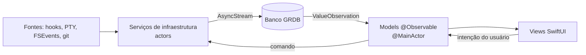

# Guia de arquitetura

O Friday é um app macOS nativo em Swift 6 e SwiftUI. Este guia define como o código se organiza, como os dados fluem e o que cada camada pode ou não fazer. O objetivo é que cada parte possa ser entendida, testada e trocada sozinha.

## Princípios

1. **A interface é projeção do estado.** Status, resumos, linha do tempo e esteira são calculados a partir de dados guardados, nunca pedidos ao modelo de IA. É isso que mantém o custo de tokens perto de zero.
2. **Dado que o agente já produz vem primeiro.** Eventos de hooks, arquivos, `git` e transcripts são a fonte. Pedir texto ao modelo é o último recurso, e quando acontece, o formato é curto e estruturado.
3. **Nunca mexer na configuração global dos agentes.** Tudo o que o Friday precisa de um agente vai por sessão: `claude --settings`, `--session-id`, variáveis de ambiente do processo.
4. **Simples antes de genérico.** Abstração nova só quando existe um segundo caso real. Protocolo só onde há troca real de implementação (produção e teste).

## Camadas

```
┌────────────────────────────── App (target Friday) ──────────────────────────────┐
│ FridayApp, cenas, composição das dependências (composition root), menus         │
└──────────────────────────────────────┬──────────────────────────────────────────┘
                                       │ usa
┌──────────────────────────── Features (FridayKit) ───────────────────────────────┐
│ Uma pasta por funcionalidade: Projects, Terminal, Sensor, Subjects, ...          │
│ Cada uma tem Views (SwiftUI) + Model (@Observable, @MainActor)                   │
└──────────────────────────────────────┬──────────────────────────────────────────┘
                                       │ usa
┌──────────────────────────── Domain (FridayKit) ─────────────────────────────────┐
│ Tipos e regras puros: Project, AgentEvent, Subject, Evidence, projeções          │
│ Sem SwiftUI, sem GRDB, sem Foundation de IO                                      │
└──────────────────────────────────────▲──────────────────────────────────────────┘
                                       │ implementa protocolos do Domain
┌──────────────────────────── Infrastructure (FridayKit) ─────────────────────────┐
│ GRDB (banco), PTY e processos, Unix socket dos hooks, FSEvents, git              │
└──────────────────────────────────────────────────────────────────────────────────┘
```

Regras de dependência:

- **Domain não importa nada** além da biblioteca padrão do Swift. É onde moram as regras que valem testar exaustivamente.
- **Infrastructure** conhece o Domain e as bibliotecas externas (GRDB, SwiftTerm). Não conhece views.
- **Features** conhecem Domain e falam com Infrastructure só por protocolo injetado.
- **App** é o único lugar que monta as dependências concretas. Nenhum singleton fora dele.

### Organização física

O código de verdade fica num **pacote Swift local, `FridayKit`**, com um módulo por camada (`FridayDomain`, `FridayInfrastructure`, `FridayFeatures`). O target do app só contém `FridayApp.swift` e a composição. Isso dá três ganhos: a fronteira entre camadas vira erro de compilação, os testes rodam sem abrir o app, e cada módulo compila sozinho.

Dentro de cada módulo, uma pasta por conceito, com arquivos nomeados pelo que contêm (`ProjectStore.swift`, `HookSocketServer.swift`). Nunca `Utils`, `Helpers`, `Common`, `Manager` genérico.

## Fluxo de dados



- O fluxo é de mão única: fonte → banco → model → view. A view nunca escreve no banco nem fala com serviço direto.
- O banco é a fonte da verdade. O model observa o banco (`ValueObservation`) em vez de guardar uma cópia que pode divergir.
- Evento externo (hook, saída de terminal, mudança de arquivo) entra por um serviço, é gravado e só então aparece na tela. Assim o app sobrevive a reinício sem perder história.

## Concorrência

- Concorrência estrita do Swift 6 ligada. Aviso de concorrência é erro a corrigir, nunca a silenciar.
- Models de tela: `@MainActor @Observable final class`.
- Serviços com estado e IO (socket, PTY, watcher): `actor`.
- Fluxos contínuos (eventos, saída de processo) são `AsyncStream`, consumidos com `for await` dentro de uma `Task` cujo ciclo de vida tem dono (o model que a criou cancela no `deinit` ou ao sair da tela).
- Tipos que cruzam fronteira de isolamento são `Sendable`. Nada de `@unchecked Sendable` sem um comentário `// SAFETY:` explicando o invariante.

## Persistência

- SQLite via GRDB em `~/Library/Application Support/Friday/friday.sqlite`.
- Toda mudança de schema é migração nova no `DatabaseMigrator`, com nome versionado (`v2-agent-events`). Migração publicada nunca é editada.
- Escrita em lote dentro de uma transação. Leitura pesada fora da main thread.
- Teste usa `DatabaseQueue()` em memória, nunca o arquivo real.

## Processos e agentes

- Processo filho tem duas portas, e só elas: sessões interativas (shell e agentes) saem de um `LaunchPlan` montado pelo `DefaultLaunchPlanner` e rodam no PTY do SwiftTerm; comandos curtos com saída lida (como `git status`) passam pelo `CommandRunner`. Nenhuma outra parte chama `Process` ou `forkpty` direto.
- App de interface não herda o PATH do shell do usuário. Agentes rodam por `$SHELL -l -i -c 'exec ...'`; ferramentas do sistema usam caminho absoluto (`/usr/bin/git`).
- O ambiente do agente recebe as variáveis do Friday (`FRIDAY_SESSION_ID`, caminho do socket) e um arquivo de settings próprio da sessão. Nada é escrito em `~/.claude` ou `~/.codex`.
- Encerrar o app encerra os processos que ele iniciou, a menos que uma decisão futura sobre sessões persistentes diga o contrário.

## Erros e logs

- Erros de domínio são `enum` tipados que conformam `LocalizedError`, com mensagem em português para o usuário.
- Erro que o usuário não pode resolver vira log, não alerta.
- Log com `os.Logger(subsystem: "com.leonchannel.friday", category: <feature>)`. Nunca `print` no código do app. Nunca logar conteúdo de arquivo do usuário, token ou variável de ambiente sensível.

## Segurança e privacidade

- Repo público: nenhum segredo, caminho pessoal ou dado de trabalho no código, teste ou fixture.
- Socket dos hooks com permissão só para o usuário (`0600`), num diretório do próprio Friday.
- Caminho do socket: `~/Library/Application Support/Friday/run/hooks.sock` quando cabe em 100 bytes (limite do `sun_path` no macOS é 104); com nome de usuário longo, cai em `/tmp/friday-<uid>/hooks.sock`. Nos dois casos o diretório é 0700 do próprio usuário e o servidor recusa diretório de outro dono.
- O script de hook nunca falha nem demora (sai 0 em ~1 s mesmo com o Friday fechado) e só envia quando `FRIDAY_SESSION_ID` e `FRIDAY_HOOK_SOCKET` existem, ou seja, só em sessões abertas pelo Friday.
- O app não usa rede a não ser que uma funcionalidade peça, e cada uso de rede é declarado neste guia.

## Quando mudar este guia

Uma decisão de arquitetura nova (camada, dependência externa, padrão de fluxo) entra aqui no mesmo PR que a introduz, com o porquê em uma linha.
